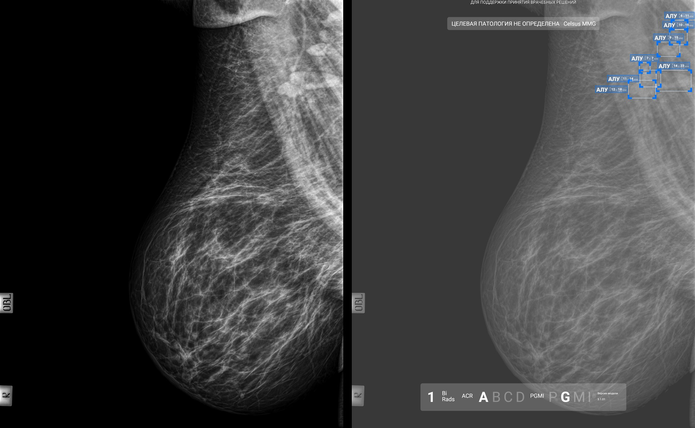
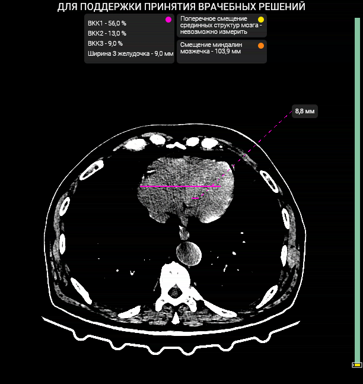
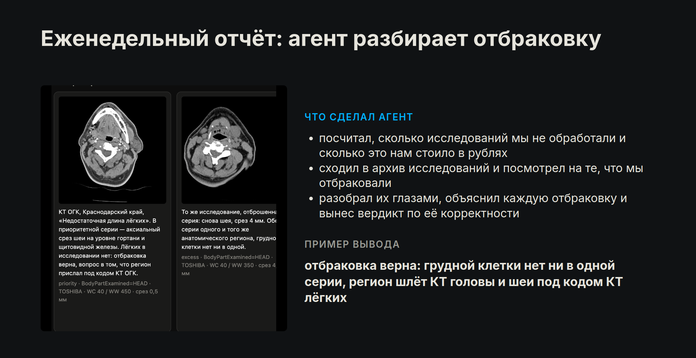

# Как протестировать то, не знаем что?

В ИИ-сервисы Цельса ежемесячно поступает более миллиона исследований. Не все из них мы обрабатываем:
- Часть отсеивается сразу при DICOM-ассоциации - например, если запрос идёт с неизвестного IP-адреса или имеет неподдерживаемый SOP Class (упрощённо говоря, тип исследования)
- Ещё часть фильтруется на бэкенде по тегам DICOM-файла. Например, неверная часть тела в теге BodyPartExamined или недостаточное количество срезов в КТ-исследовании для анализа
- Что-то идёт в отказ на ML-ядре, там уже анализируется сама картинка. Скажем, тег может быть верный, но на самом деле на картинке не та целевая область, или качество изображения слишком низкое
- Наконец, могут быть просто технические ошибки - не хватило RAM, баг в коде

Летом на этапе валидации исследования по тегам за пару недель мы выкинули 85 КТ-исследований. КТ - это стопка двумерных срезов. Если между срезами слишком большое расстояние, маленькие находки могут проскочить между ними, поэтому такие серии мы не берём. Да и в функциональных требованиях от НПКЦ написано, что максимальное допустимое расстояние между срезами - 3 миллиметра.

Расстояние между срезами считается как разница координат соседних срезов. Координаты лежат в DICOM строками вроде -1023.661, а наш код переводит их в double. Десятичную дробь в двоичном виде точно не записать, как 1/3 в десятичном, поэтому каждая координата хранится с крошечной погрешностью. Обычно у соседних срезов она одинаковая и при вычитании сокращается. Но на отметке 1024 точность double меняется, и у пары срезов по разные стороны от неё погрешность проявляется: -1023.661 - (-1026.661) = 3.0000000000001137. В нашем коде делается строгое сравнение с 3.0, поэтому такие исследования улетали в отбраковку, хотя ничем не отличались от тех, где шаг ровно 3 мм. Все 85 были с аппаратов Siemens - у них координаты срезов как раз в районе минус тысячи миллиметров.

Обнаружилась эта проблема при разборе ИИ-агентом отбракованных исследований за прошлый месяц. Сложность была не в правке или написании теста (и то, и другое сделали за пять минут), а в том, что никто и не знал, что такой тест надо написать.

Недавно я выступал на конференции Heisenbug и рассказывал про особенности тестирования и мониторинга медицинских ИИ-систем в целом, а в этом посте хочу порассуждать именно о том, как эти процессы меняют ИИ-агенты.

У медицинских ИИ-систем есть ряд таких особенностей, которые затрудняют тестирование:
- Это ML-системы, а в них самые опасные баги - "тихие". Все алерты зелёные, формально всё работает, результат доставляется клиенту, но он некорректный
- Основным результатом работы системы чаще всего является DICOM SC - по сути картинка с вшитой прямо в пиксели разметкой. Картинки тестировать автоматически значительно сложнее, чем структурированные объекты типа JSON
- Большая часть процесса обработки исследования лежит вне зоны нашего контроля. Пациент приходит в больницу, аппарат делает снимок, тот уходит в архив больницы (PACS - Picture archiving and communication system). Дальше он идёт к нам напрямую через защищённый канал или, в большинстве случаев, через федеральную платформу МосМедИИ. Наш сервис принимает исследование, модель ищет патологии и отдаёт картинку с обведёнными находками (DICOM SC) и текстовое заключение с измерениями (DICOM SR). Наконец, всё это уходит обратно врачу, который смотрит результат в DICOM-вьюере. То есть многое зависит не только от нашего ПО, но и от стороннего медицинского, которое славится своей консервативностью и медленными апдейтами
- Деплоить приходится не только в облаке, но и в различных закрытых контурах - от локального сервера в ЦОДе региона до кузова грузовика в передвижном рентген-комплексе
- Огромное разнообразие аппаратов, настроек, тегов, часть тегов может заполняться вручную лаборантом

Компания при этом у нас небольшая, заказчиков с разным ПО и железом - много, количество различных метрик, алертов, логов - огромное. На помощь приходят ИИ-агенты, которые снимают ряд ограничений:
- что мы в принципе можем проверять
- какой объём информации мы можем проверять
- кто может проверять

## Поиск тихих багов на потоке

Баги ML-моделей или визуализации результатов очень сложно поймать фиксированными алертами, так что это идеальный кейс для применения ИИ-агентов. Для этого мы дали им доступ к нужным инструментам - чтение БД, логов, тегов, изображений.

Раньше фиксированный набор тестов и алертов проверял лишь то, с чем мы уже сталкивались или смогли придумать в качестве эдж-кейсов. Сейчас же агент может перемалывать хоть весь поток. Таким образом, помимо истории с шагом между срезами, нашлось множество других штук, например:
- **CHESTABDOMEN.** Фильтр по тегу части тела должен был отсекать снимки живота и проверял вхождение разных других частей тела в значение тега - например, `BodyPartExamined.Contains("abdomen")`. В одной из медицинских организаций в теге у рентгенов органов грудной клетки, захвативших верх живота, стоит значение `CHESTABDOMEN`. Такие снимки мы обрабатываем нормально, но фильтрация по тегам их резала.
- **Бледная маммограмма.** В DICOM есть тег с "таблицей яркости" VOI LUT, он показывает, как переводить сырые значения пикселей в оттенки серого, которые увидит врач. Наш код рендерера её игнорировал, и врач в итоге видел бледную картинку, которой неудобно пользоваться. Агент проанализировал таблицу технических дефектов, которую прислали нам с платформы, и нашёл общий тег у всех исследований с проблемами.
- **Удвоение находок после релиза маммографии.** На просьбу человека проанализировать новый релиз агент обнаружил, что удвоилась частота нахождения определённого класса - с 5 на 100 исследований до 10. Это ещё не явный баг, но сигнал, что стоит проверить работу модели.

*Слева оригинал во вьюере, справа картинка с разметкой*

В подобных случаях агент не заменяет тесты - скорее, его находки становятся причиной написать новые тесты. Подобные кейсы уходят в регресс-датасет. Получается своего рода разделение труда: детерминированные тесты защищают от известных нам ошибок, а агенты ищут то, с чем мы раньше не встречались.

У QA-специалистов для этого давно есть термин - исследовательское тестирование (exploratory testing). В этом случае человек не идёт по строгому чек-листу, а сам изучает систему и решает, куда копать дальше. Раньше у нас оно упиралось в человеческие ресурсы, поэтому его делали выборочно и перед большими релизами. Агент может делать то же самое постоянно и на реальном продакшн-потоке.

## Визуальный анализ

Кроме тегов современные модели могут анализировать и сами изображения. Даже самая топовая VLM не сможет нормально определять, хорошо или плохо отработала наша модель с клинической точки зрения, но вполне способна отвечать на более простые вопросы - скажем, отрисованы ли на изображении объекты вне целевой области и вообще верный ли орган на снимке. Однажды мы ослабили фильтрацию по одному из тегов, чтобы обрабатывать больше КТ мозга. Процент обработки действительно вырос, вот только мы стали брать в обработку и случайно залетевшие на анализ КТ органов грудной клетки.

*Измерения желудочков мозга, нарисованные на срезе грудной клетки*

Ещё ИИ-агентов очень удобно использовать для анализа проверочных паков от новых потенциальных клиентов. Раньше каждый архив нужно было разобрать руками, проверить корректность тегов и самих изображений, вручную проверить визуализацию найденных объектов. Теперь же агент может взять всю работу на себя - достаточно кинуть в чат архив с исследованиями. Недавно новый клиент прислал пак на проверку - 20 маммограмм и 19 рентгенов в формате JPEG. Агент сам перевёл их в DICOM-формат, обработал и проверил отрисовку на DICOM SC. Оказалось, что с нашей стороны всё корректно (нет находок вне целевой области, находка обнаружена на обеих проекциях), а вот в пиксели снимков вшиты ФИО и дата рождения пациентов, и это стоит обсудить с клиентом до начала интеграции.

Раньше еженедельный или даже ежемесячный анализ всего потока был крайне дорогостоящим. Нужно собрать статистику, проанализировать тренды, а также отобрать исследования для анализа - например, сэмпл исследований, которые были отбракованы и не взяты в обработку, и наоборот, сэмпл исследований с нетипичными значениями тегов, которые были обработаны. Теперь этот анализ может выполняться чаще и в сильно большем масштабе. Раньше каждое падение процента обработки у клиента должно было быть проверено аналитиками или инженерами. Теперь же первый уровень проверки автоматизирован, и в большинстве случаев проджект-менеджерам даже не надо ставить задачу команде, ведь чаще всего это проблемы на стороне клиентов. Например, неверно настроена маршрутизация, и в систему по анализу КТ органов грудной клетки попадают КТ головы и шеи.

*Слайд из доклада: агент открыл отбракованные КТ из Краснодарского края и нашёл в них шею вместо грудной клетки*

Может возникнуть вопрос - зачем вообще нужны агенты, чем плох фиксированный скрипт? Скрипт выполняет только те проверки, что мы в него заложили, агент же может выбрать следующий шаг на основе результатов предыдущего. Но если агенту при каждом запуске нужны одни и те же данные (как в случае с еженедельным отчётом), их лучше вынести в детерминированный шаг, а модели оставить интерпретацию и возможность запросить дополнительные данные.

## Тестировщиком становится каждый

Бот в Маттермосте доступен не только инженерам, теперь любой сотрудник может расследовать потенциальную проблему. Вот реальные примеры запросов менеджеров из практики:
- "Посмотри, по какой причине и корректно ли отклонены вот эти исследования". Агент сверил логи приёма, отрендерил снимки и ответил, что отклонены корректно - во всех трёх только боковая проекция, прямой нет
- "Уже 30 минут нет ни одного исследования, есть ли проблема и решаем ли мы её". Бот ответил, что проблема есть, но не на нашей стороне - платформа перестала направлять задачи всем вендорам, а через полчаса сам написал в тред, что поток пошёл
- "Проверь обработку в регионе X после переезда". Агент посмотрел логи ML-ядра и выяснил, что от региона уже двое суток не пришло ни одного запроса, хотя ещё в сентябре на него приходилась пятая часть всех запросов к этому ядру. После переезда в новое облако у нашего ядра сменился IP-адрес, и его нужно было добавить в вайт-лист на стороне региона

Раньше каждый такой вопрос был задачей на инженера: сходить в базу, выгрузить, объяснить, проконтролировать. Поэтому большую часть таких вопросов просто не задавали, чтоб не заваливать людей работой. Так что агенты не просто разгрузили инженеров, а ещё и создали дополнительный пул проверок, которых раньше не существовало. Когда данные и их анализ становятся более доступными, вопросов становится больше, и всплывает то, что раньше бы никто не заметил.

## Ограничения

- **Агент видит только те данные, к которым у него есть доступ.** Если в мониторинге или логах чего-то нет, агент не сможет магически придумать эту информацию. Так при эвале агентов на прошлых инцидентах мы обнаружили, что не собирается часть важных метрик по дискам БД
- **Агент не может протестировать в среде, к которой у нас нет доступа.** Наши DICOM SC годами нормально уходили к клиентам в PACS, а один пакистанский начал рвать соединение: по одному из старых пунктов стандарта DICOM длина значения каждого тега должна быть чётной в байтах, у нас она иногда получалась нечётной. Остальные PACS молча дописывали нулевой байт на своей стороне. Несколько лет назад была проблема с сервером заказчика с видеокартами 2016 года, на которых CUDA-модуль сети тихо возвращал нулевые тензоры.
- **Агент сам может ошибиться.** Агенты - это такие же ИИ-системы, и их тоже надо тестировать. Про наши эвалы и реплеи инцидентов я писал [здесь](https://crazyfrogspb.github.io/2026/09/24/kak-my-ne-dayom-agentam-vrat-i-lomat-prodakshn/). Плюс каждый вердикт агент сопровождает "уликами" со ссылками - при желании можно перепроверить всё руками
- **Находок может стать больше, чем рук.** В идеале каждый фикс даже мелкого бага тоже надо протестировать, и это может быстро забить очередь на тестирование. Либо нужно полностью автоматизировать систему ревью и тестирования, либо постоянно откладывать фиксы незначимых багов

## Итог

Написать тест на значение тега несложно, но сложнее догадаться, что он нужен. Агенты дали нам возможность систематически изучать те аспекты работы наших систем, до которых у нас не было ресурса добраться.

Доклад я закрыл нашим старым мемным вопросом: заменит ли ИИ врача? Частично - да, и не только врача, но и тестировщика, и CTO. Так что отбросьте предрассудки, в старые времена ручного кодинга и тестирования мы уже не вернёмся.
