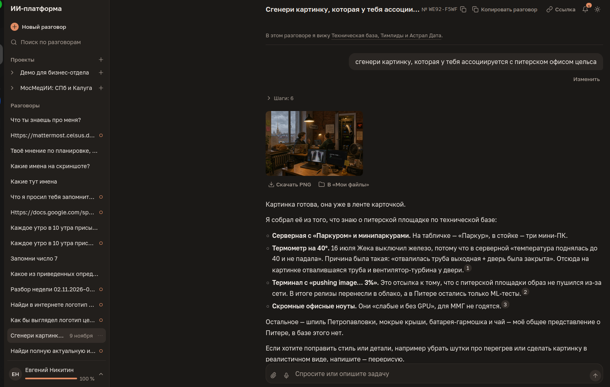
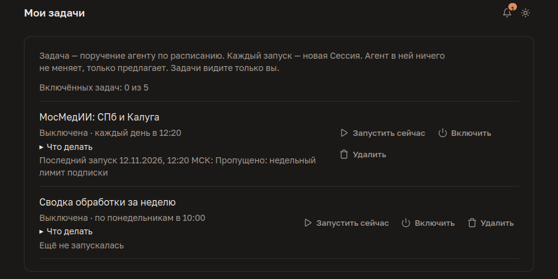
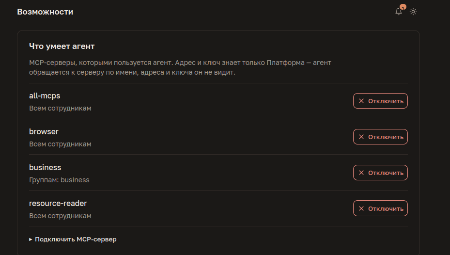
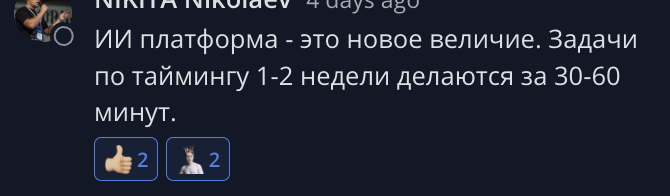

# Как мы за три месяца построили ИИ-платформу для всей компании

В прошлых постах я в основном рассказывал про ИИ для инженеров - кодинговые агенты, ИИ-дежурный, тестирование и всё такое. Но в любой компании, даже самой айтишной, есть куча людей, которые ни разу в жизни и в терминал-то не заходили - юристы, HR, продажи, финансы, руководители. В лучшем случае они сейчас используют известных чат-ботов типа ChatGPT, и то не факт. Почему этого в любом случае недостаточно?
- Высокая вероятность оттока - не все готовы справляться со сложностями доступа, оплаты, VPNами и блокировками аккаунтов
- Неконтролируемое использование - люди могут пользоваться агентами очень неэффективно, плюс есть риски, связанные с утечкой персональных и чувствительных коммерческих данных
- Даже хорошо настроенный человеком чат-бот обычно мало знает про компанию и не имеет доступа к её внутренним инструментам
- При уходе сотрудника все его наработки пропадают вместе с личным аккаунтом
- Невозможно нормально масштабировать хорошие практики - как минимум потому, что про них никто не узнает

С августа мы делаем ИИ-платформу, чтобы решить эти и другие проблемы. Сейчас она работает у нас в Цельсе и у моего товарища в не-айтишной компании. Дальше расскажу подробнее, зачем мы её делали, что она умеет, как устроена внутри, и на какие грабли мы уже успели наступить.

## Зачем мы сделали платформу?

Изначальная идея, которую я закинул в агента, звучала так - сотрудник открывает платформу в браузере и получает чат-бота, который знает инфу про нашу компанию. Сотруднику не нужно ставить CLI, настраивать MCP и разбираться с доступами, скиллами и промптами - ему нужен только логин. Агент отвечает согласно правилам компании, ссылается на внутренние документы и имеет доступ только к той информации, которая должна быть доступна этому сотруднику.

Мы пробовали поднимать подобную фигню (тогда она называлась ИИ-вики) ещё в 2024 году. За основу взяли проект Danswer, который сейчас называется [Onyx](https://github.com/onyx-dot-app/onyx). Признаюсь - идея не особо взлетела, хотя тогда я отзывался положительно. Да, [какая-то польза была](https://crazyfrogspb.github.io/2024/12/30/text2sql/), плюс в процессе мы много чего узнали про построение подобных систем, но основным блокером стало качество ответов и сложность поддержки нормального RAG.

Сейчас эта проблема в основном решена - зрелый харнесс с мощной моделью из коробки хорошо справляется с большинством задач - дай только инструменты и знания о компании. А вот как их выдать удобно и безопасно на уровне всей компании - отличный вопрос. С чего начать-то?

Мы сформулировали четыре технических кита, на которых всё должно стоять:
- **Удобный доступ** - веб-чат с логином через учётку компании, без установок и личных аккаунтов в ИИ-провайдерах
- **Пополняемые знания** - обновляемая вики компании, которую ведут агенты на основе разных источников, а люди только разбирают спорные моменты
- **Инструменты** - подключения к внутренним системам компании с правами конкретного сотрудника
- **Безопасность** - права, аудит, защита персональных данных (сразу оговорюсь - совсем не отдавать данные внешнему провайдеру можно только с локальными моделями, а это очень-очень дорого для небольших компаний и довольно сильно хуже по качеству)

При таком подходе, если по какой-то причине нам нужно сменить ИИ-провайдера, на нашей стороне остаётся вся начинка - база знаний, истории диалогов, настройки. Достаточно простым действием в админке шлюза переключить всех на другую модель.

Прежде чем приступить к разработке, мы зафиксировали, что мы НЕ делаем:
- **Не форкаем опенсорс**. Мы какое-то время попользовались OpenWebUI, но настраивать и кастомизировать его было той ещё болью. За последнее время он неплохо вырос - появились агентный режим, MCP, навыки и память, но чужое решение развивать всё-таки не хотелось, слишком накладно, в ИИ-эпоху проще сделать решение под себя
- **Не используем enterprise-тарифы с оплатой за токены** - мы не готовы платить 2 миллиона рублей в месяц
- **Не используем готовые облачные решения для команд от ИИ-провайдеров** - не хочется вендор-локаться под конкретного провайдера, опять же хочется кастомизировать под себя. Сложно или невозможно настроить безопасные доступы до внутренних систем компании
- **Не хостим свои модели** - слишком дорого или недостаточное качество
- **Не используем векторные или графовые БД как основной источник знаний** - сложно поддерживать, непонятна ценность на нашем масштабе

## Что умеет платформа?

Вот какая основная функциональность сейчас есть на платформе:
- **Чат с агентом**, который видит базу знаний компании (в рамках прав сотрудника) и отвечает со ссылками на документы из этой базы. Агент показывает свои шаги для прозрачности - что читает, что ищет, какие инструменты вызывает
- **Загрузка документов в базу** - сотрудник может кинуть файлы (от сканов PDF до чертежей из Автокада), а агент разложит их по папкам базы знаний
- **Личная память** - на экране "Что агент помнит обо мне" можно посмотреть заметки и поправить агента
- **Мои файлы** - личное хранилище файлов, агент может получить доступ к ним в любом разговоре
- **Мои навыки** - удачный сценарий можно сохранить в скиллы кнопкой прямо из диалога. Админ может промоутить удачные навыки на группу сотрудников или на всю компанию, служебный агент раз в сутки предлагает админам кандидатов среди личных навыков (можно отключить, если не хочется лезть в личные скиллы)
- **Задачи по расписанию** - например, "каждый понедельник собери сводку по откликам". Если агент замечает, что человек часто повторяет один и тот же запрос, он сам может предложить сделать из него регулярную задачу
- **Голосовые сообщения** - расшифровываются локальной моделью прямо в кластере
- **Поиск по прошлым разговорам** - часто люди говорят что-то типа "а помнишь вот в том разговоре...", так что агенту нужен доступ к прошлым сессиям
- **Проекты** - папки с разговорами со своей инструкцией и закреплёнными файлами
- **HTML-артефакты** со ссылками для коллег
- **Генерация картинок** с лимитами на сотрудника
- **Правки прошлых реплик** - чтобы откатиться назад в диалоге, который пошёл не туда

**Для админа**:
- **Папки и доступ** - права на разделы базы знаний (можно выдать по группам или поимённо)
- **Источники** - откуда ежедневно агент пополняет базу знаний (например, каналы Маттермоста или гугл-доки)
- **Общие навыки** - навыки на группу или компанию
- **Возможности** - подключения к внешним системам (типа Битрикса или какой-нибудь БД) через MCP, всем или отдельным группам
- **Обратная связь** - лайки, дизлайки и жалобы на ответы агента

Подробную статистику и расходы сейчас можно посмотреть в отдельных дашбордах. Алерты приходят в выбранный канал оповещений - например, если у кого-то кончились лимиты на подписке. Кроме того, служебный агент регулярно:
- Разбирает базу знаний на предмет дубликатов и противоречий, просит администраторов их пофиксить, если не может сам
- Раз в неделю изучает все сессии на предмет ошибок агента - где не хватило доступов или информации

Важный момент - админы сами не читают диалоги пользователей, но сервисный агент платформы читает все сессии и предлагает, что можно улучшить. Всё-таки это рабочий инструмент, где люди должны обсуждать рабочие задачи, и проблемы мы в этом не видим.

## Как технически устроена платформа?

**Под капотом используется готовый сторонний харнесс.** Писать с нуля свой харнесс и реализовать всю ту же функциональность смысла нет никакого. К любому харнессу можно легко прикрутить любые подписки и модели. Так что в любой сессии запускается тот же самый харнесс, что запускают технари в терминалах - именно он ведёт диалог, вызывает инструменты, запускает субагентов и работает с файлами. Платформа - это большая надстройка вокруг него - права, знания, инструменты, логирование, интерфейс.

**Каждая сессия запускается в отдельном поде Кубернетеса.** Границы пода совпадают с границами прав сотрудника - в момент создания сессии фиксируется текущий слепок прав, и под собирается под него. После 15 минут простоя под удаляется, а если сотрудник вернулся - поднимается заново в той же рабочей директории.

**Права ограничиваются через монтирование, а не через инструкции.** База знаний разбита на разделы с правами на чтение и запись. Недоступный сотруднику раздел не монтируется в его под, и агент просто не видит лишних файлов.

**База знаний - это отдельный git-репозиторий на компанию.** В git лежат только маркдаун-файлы, оригиналы документов сохраняются в S3. Писать в базу можно только одним путём - через публикацию в ядре платформы. Каждая запись становится коммитом от имени конкретного человека с проверкой базовой версии, чтобы не затереть чужую правку. Векторной базы нет - агент сначала смотрит оглавление раздела, а потом ищет по самим файлам (так же, как кодинговый агент ищет по репозиторию). На нашем объёме этого пока хватает с головой.

**Журнал событий только дописывается.** Всё, что происходит в сессии (реплики, вызовы инструментов, подтверждения, публикации) записывается в журнал в PostgreSQL. Лента чата, учёт расходов, статусы - это всё разные проекции этого журнала. Если связь с чатом оборвалась, ничего не теряется - после переподключения он просто догружает из журнала всё, что пропустил за время отсутствия.

**В поде не лежат секреты.** Вместо ключа к модели там лежит плейсхолдер, настоящий секрет подставляет наш LLM-прокси на выходе. У пода также нет доступа к базе данных, к git на запись и к конфигурации платформы. Во внешние системы, например в Битрикс, агент ходит через наш MCP-реестр от имени сотрудника. Он может сделать там ровно то, что мог бы сделать сам сотрудник (либо по желанию можно ограничить агента сильнее).

**Авторизация** происходит через OIDC-провайдер, в нашем случае это Authentik. Сотрудник входит через свою рабочую учётку, а права выдаются по группам: например, вся группа "Сейлы" видит папку базы знаний с ценами и может работать с Битриксом.

**Деплой** - это один Helm-чарт на каждую компанию. Наша инсталляция и инсталляция в компании товарища - это один и тот же чарт с разными значениями. Для пилотов в чарт можно включить встроенные в платформу git-сервер, S3 и OIDC-провайдер, чтобы не требовать от клиента готовой настроенной инфраструктуры. Все запросы к ИИ-провайдерам ходят через уже написанный ранее LLM-шлюз с кучей функциональности - от маскирования чувствительных данных до создания пулов пользователей на одной подписке.

Платформа почти целиком написана агентами по методологии [BMad](https://docs.bmad-method.org/). Флоу примерно такой - брейншторм → PRD → архитектура → эпики и стори → реализация → ревью → автоматическое и ручное тестирование на платформе. Регресс поведения агента проводится через несколько десятков сценариев на настоящей модели по синтетической базе знаний вымышленной компании, отчёт служит блокирующим гейтом в CI. Время от времени несколько ИИ-ревьюеров параллельно проходят по всей кодовой базе - последний такой аудит нашёл потерю реплик и обход запретов в авто-режиме.

Конечно, не обошлось без разного рода граблей, расскажу про самые показательные.

**Изоляция.** Первая идея была довольно простой - фильтровать доступы только на уровне инструментов, то есть разрешать чтение одних путей и запрещать другие. Анализ журнала показал, что агент сделал 96 вызовов шелла и только 6 чтений через встроенный инструмент чтения. Видимо, агенту удобнее сделать `cat` или `grep`. Песочница внутри пода тоже не заработала - то падала на AppArmor, то требовала привилегированного контейнера, то ещё что-то. Поэтому пришли к решению с монтированием: физически не даём агенту читать чужие файлы.

**Жизнь пода.** Под удаляется после простоя, и до начала ноября вместе с ним пропадали все рабочие файлы агента. У сессии было три разных хранилища (журнал, файлы и транскрипт самого харнесса), и путать их не стоит. Теперь рабочие файлы сохраняются в S3 и возвращаются, когда под поднимается заново.

**Поведение агента.** Агенты очень любят то срезать углы, то, наоборот, излишне проявлять инициативу. Например, агента попросили сделать презентацию для внешней аудитории, а он без спроса добавил туда цифры, которые сам посчитал по внутренней таблице. В другой раз попросили сделать дайджест статей, а он прочитал только аннотации и выдал это за полноценный разбор. К сожалению, полностью это не пофиксить - поэтому и нужен регулярный разбор сессий, полное логирование и сбор фидбека от пользователей.

## Как пользуются платформой?

Платформа работает всего три месяца, так что делать количественные выводы рано. Но несколько показательных примеров уже есть.

У нас:
- **Письмо региональному заказчику про ошибки в данных.** Агент сам сходил в базу данных и собрал ошибки по всем модальностям за месяц, больницы с наибольшим числом ошибок и приложения с идентификаторами исследований
- **Аудит сайта компании.** Агент сверил продуктовые страницы с тем, что реально умеют наши модели, предложил правки текста, сделал картинки и анимации статистики в корпоративных цветах. На выходе получился готовый патч сайта
- **Подготовка к выступлению** - презентация на 14 слайдов в шаблоне компании и текст для суфлёра на 20 минут

В не-айтишной компании:
- **Отчёты руководителя.** Операционный директор собирает с агентом ежемесячные отчёты по выгрузкам из рабочих систем. Свой способ составлять отчёт пользователь в итоге сохранил навыком, и агент теперь сам применяет его в новых разговорах
- **Совещания в задачи.** Агент разбирает записи внутренних совещаний и раскладывает их по задачам в Битриксе
- **Документы по образцу** - доверенности, анкеты для клиентов по шаблону и каталогу услуг
- **Маркетинг** - листовка в Figma с вылетами под печать, правка цен в готовых PDF

## Итоги

По итогу мы прошли путь от идеи "дать сотрудникам чат-бота с доступом к внутренним документам" до полноценной платформы с базой знаний, инструментами, правами и регулярными задачами. Почти всю агентную часть мы взяли из готового харнесса, а основные силы вложили в обвязку вокруг него. Дать агенту доступ к файлам и инструментам несложно. Сложнее сделать так, чтобы это всё работало надёжно, качественно, безопасно и прозрачно.

Дальше будем следить за использованием платформы, добавлять функциональность, править ошибки и, главное, разбираться, какие сценарии экономят больше всего времени и как масштабировать удачные практики сотрудников на всю компанию.
